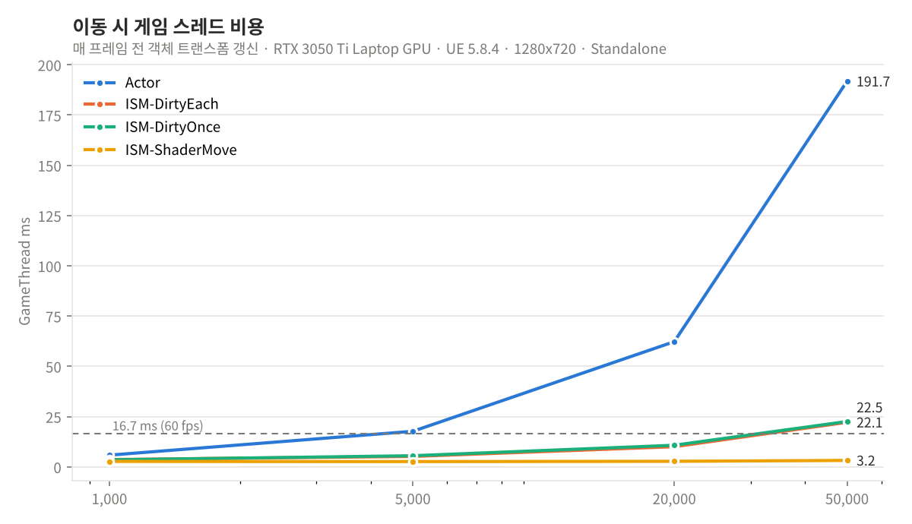
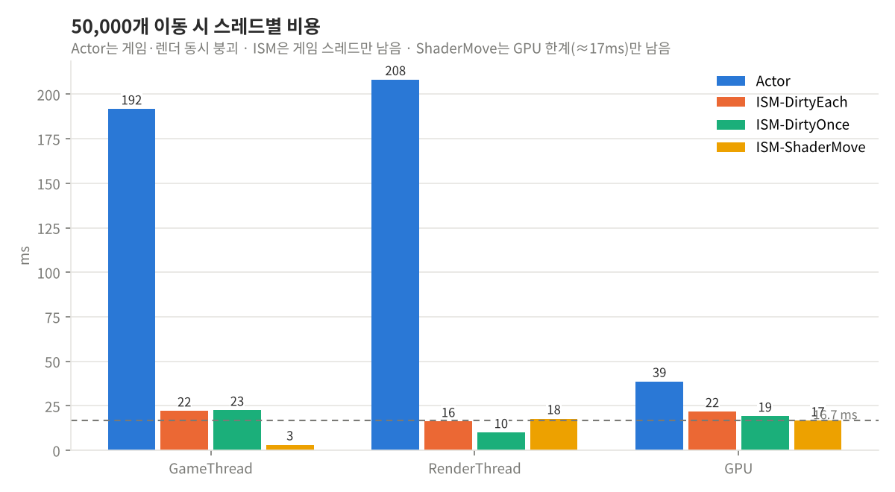
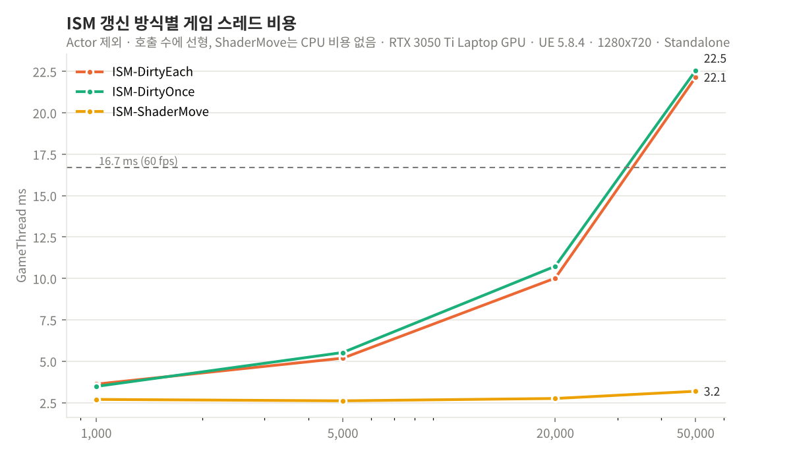
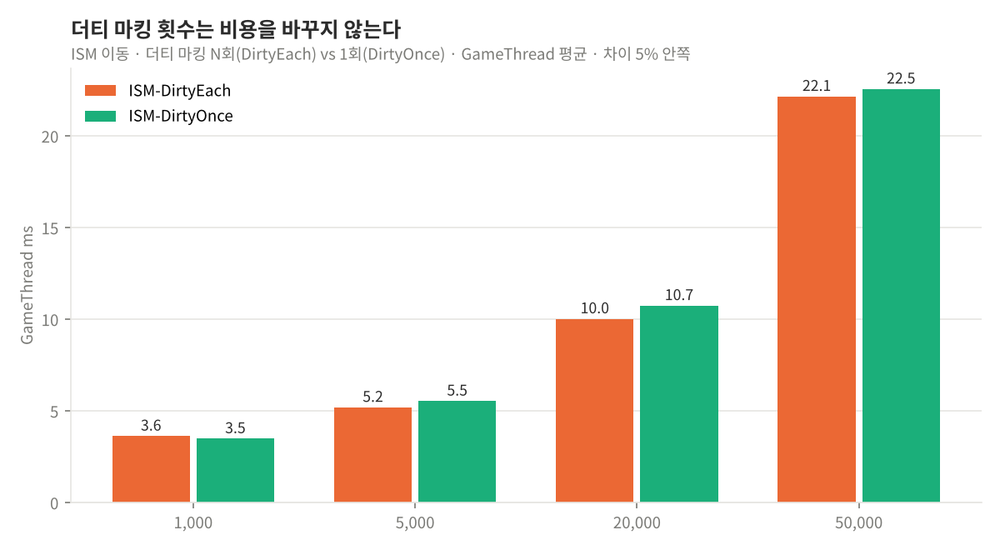
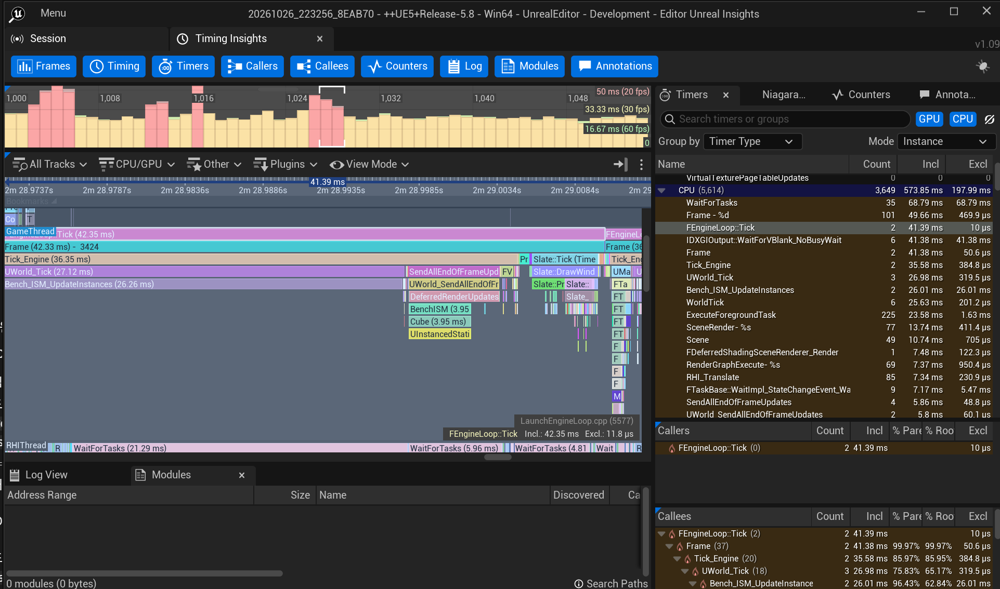
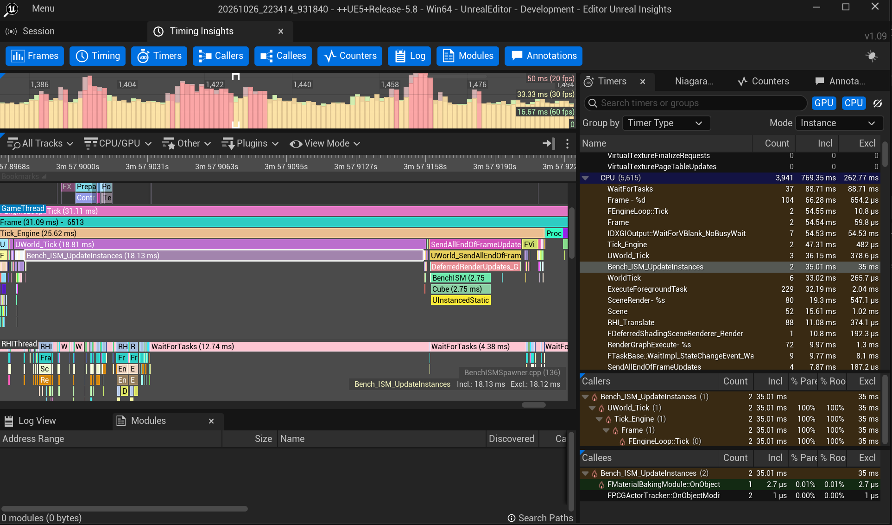

# ISM 갱신 비용은 어디서 나오는가

2026-10-27 · 이성호

대량 객체 처리에서 생긴 성능 병목을 변수별로 분리해 측정하고, 엔진 내부 동작을 근거로 원인을 추적하고, 성능 예산에 맞는 방식을 고르는 과정을 보여주는 문서다. 소재는 ISM 갱신 비용이다. 실무에서 직접 겪고 고친 병목이고, 회사 자산 없이 같은 구조를 재현할 수 있으며, 결과를 숫자로 잴 수 있어서 골랐다. 여기서 쓴 절차(변수 분리 → 측정 → 구조로 원인 추적 → 예산 기준 선택)는 다른 성능 문제에도 그대로 쓴다. 측정값은 이 문서에서 직접 쟀고, 실무 상황은 공개할 수 있는 범위에서 진술한다.

**결론 세 가지 (UE 5.8, Standalone, 5만 개 이동)**

- `UpdateInstanceTransform`의 더티 플래그를 5만 번 주든 1번 주든 게임 스레드 비용이 같다(8회 측정, 차이 5% 안쪽). 엔진이 프레임 끝에 한 번 모아 처리하기 때문이다.
- 비용은 호출 수에 선형이다. 호출당 약 0.4μs, 5만 개면 게임 스레드 +20ms.
- 이동을 머티리얼(WPO)로 넘기면 인스턴스별 CPU 갱신 호출이 사라지고 게임 스레드가 빈 씬 수준(+0.6ms)이 된다. 대신 CPU가 위치를 모른다.

엔진 내부를 수정한 것은 아니다. 엔진 기능을 쓰는 쪽에서의 비용 분석이다.

## 1. 문제

실무(UE 5.4)에서 ISM 컴포넌트 4개에 담긴 수천 개 인스턴스를 매 프레임 갱신하다 8fps까지 떨어졌다. 당시 두 가지를 함께 수정해 평균 60fps로 복구했다.

- 같은 인스턴스를 한 프레임에 두 로직에서 각각 갱신하던 구조를 1회로 통합
- `UpdateInstanceTransform`의 `bMarkRenderStateDirty`를 매 호출 true에서 마지막 1회만 true로 변경

병목 발견, 프로파일링, 수정, 검증을 직접 했지만 두 수정을 동시에 적용했기 때문에 효과가 어느 쪽에서 왔는지 분리하지 못했다. 이 벤치는 그 질문에 답하려고 만들었다. 회사 자산은 쓰지 않고, 같은 구조를 개인 프로젝트에서 재현했다.

## 2. 실험 설계

같은 씬(고정 카메라, 같은 배치, 같은 움직임)에서 방식만 바꿔 가며 쟀다. 변수는 방식, 객체 수(1천/5천/2만/5만), 정지·이동 세 가지뿐이다.

| 방식 | 객체 당 구조 | 매 프레임 CPU가 하는 일 |
|---|---|---|
| Actor | Actor 1개 + StaticMeshComponent 1개 | 각 액터 Tick에서 `SetActorLocation` |
| ISM-DirtyEach | ISM 컴포넌트 1개에 전부 | `UpdateInstanceTransform(i, T, true, bMarkDirty=true)` × N |
| ISM-DirtyOnce | 위와 동일 | 같은 호출, 더티 플래그는 마지막 인스턴스에만 true |
| ISM-ShaderMove | 위와 동일 | 없음. 방향·위상만 CustomData에 1회 기록, 이동은 머티리얼 WPO가 계산 |

DirtyEach와 DirtyOnce는 `bMarkRenderStateDirty` 인자 하나만 다르다. 엔진 헤더 주석이 권장하는 방식이 DirtyOnce다.

공통 조건: 엔진 기본 큐브(12 tris, 스케일 2×0.15×0.15), 충돌 없음. 배치는 한 점에서 부채꼴(좌우 ±60°, 상하 −5°~+25°)로 뻗는 탄막이다. 각 인스턴스의 방향과 초기 반경은 인덱스 해시로 결정되어 실행마다 같고, 이동은 반경 6000cm 안에서 속도 1500cm/s로 날아가다 되감는다(`BenchLayout.h`). 방향·초기 반경은 스폰 때 배열에 캐시하고 매 프레임 루프에는 `fmod` 하나만 남겼다. 스포너는 같은 인터페이스(`IBatchSpawner`)를 따르고, 자동 sweep이 모든 조합을 같은 순서로 재서 CSV에 기록한다. 워밍업 60프레임을 버리고 60프레임 평균을 쓴다.

측정값은 `stat unit`과 같은 소스다. Game/Render/RHI = `GGameThreadTime` / `GRenderThreadTime` / `GRHIThreadTime`(대기 제외 작업 시간), GPU = `RHIGetGPUFrameCycles()`.

## 3. 측정 환경

노트북 RTX 3050 Ti (4GB), UE 5.8.4, 1280×720 창 모드. 렌더링 기능 비용이 객체 처리 비용을 가리지 않도록 다섯 가지를 껐다.

| 설정 | 기본 | 벤치 | 이유 |
|---|---|---|---|
| `r.DynamicGlobalIlluminationMethod` | 1 (Lumen) | 0 | GI 비용 제거 |
| `r.ReflectionMethod` | 1 (Lumen) | 0 | 반사 비용 제거 |
| `r.Shadow.Virtual.Enable` | 1 | 0 | 가상 섀도맵 → 일반 섀도맵 |
| `r.RayTracing` | True | False | 인스턴스별 가속 구조 비용 제거 |
| `r.GenerateMeshDistanceFields` | True | False | 거리장 갱신 비용 제거 |

측정값을 그대로 믿지 않고 걸러낸 것:

- **프레임 시간은 비교 지표에서 제외.** 노트북 표시 경로와 PIE 창 모드가 60Hz에 묶여 `t.MaxFPS 0`, `r.VSync 0`으로도 풀리지 않았다. 대기를 제외한 스레드 시간과 GPU 시간으로만 비교한다.
- **에디터 오버헤드 약 6ms.** 빈 씬 게임 스레드가 PIE 9.3ms, Standalone 3.5ms. PIE 수치는 같은 sweep 안에서만 비교하고, 최종 수치는 Standalone에서 쟀다.
- **에디터 백그라운드 절전.** 창이 포커스를 잃으면 3fps로 떨어져 렌더 스레드 0ms, 프레임 333ms 같은 이상값이 나왔다. 해당 설정을 끄고 재측했다.
- **벤치 자체의 계산을 루프에서 뺀다.** 처음에는 탄환 방향을 매 프레임 계산했는데(해시 + 삼각함수), 그 비용이 5만 개에서 85ms로 측정값을 덮었다. 방향·반경을 스폰 때 배열에 저장하고 루프에는 fmod 하나만 남겨, 측정값이 갱신 API 비용만 반영하게 했다.

최종 수치는 Standalone 5회 측정 중 회차 2개(`sweep_20261027_232920`, `sweep_20261028_191950`)의 평균이다. 나머지 3회는 연속 실행으로 노트북 CPU 클럭이 떨어져 제외했다. 빈 씬 게임 스레드가 2.6ms에서 9~10ms로 3배 늘어난 것으로 판별했다. 단 그 3회에서도 방식 간 비율과 결론은 동일했다. GPU 시간은 5회 편차가 1~2ms로 안정적이었지만, 빈 씬의 하늘·구름 비용(약 11ms)이 포함된 값이다.

## 4. 결과

5만 개 이동 상태에서 세 계단이 나온다. Actor는 게임·렌더 스레드가 함께 무너지고, ISM은 게임 스레드만 올라가며, ShaderMove는 빈 씬과 같다. (Standalone 1280×720, 2회 평균. 빈 씬 게임 스레드 2.6ms)

| 방식 | 게임 (ms) | 빈 씬 대비 순증가 | 렌더 (ms) | GPU (ms) |
|---|---:|---:|---:|---:|
| Actor | 191.7 | +189 | 208.2 | 38.7 |
| ISM-DirtyEach | 22.1 | +19.5 | 16.2 | 21.8 |
| ISM-DirtyOnce | 22.5 | +19.9 | 10.0 | 19.2 |
| ISM-ShaderMove | 3.2 | +0.6 | 17.9 | 16.6 |

객체 수를 늘릴 때 게임 스레드 추이 (이동 상태, ms):

| 방식 | 1천 | 5천 | 2만 | 5만 |
|---|---:|---:|---:|---:|
| Actor | 5.8 | 17.7 | 62.2 | 191.7 |
| ISM-DirtyEach | 3.6 | 5.2 | 10.0 | 22.1 |
| ISM-DirtyOnce | 3.5 | 5.5 | 10.7 | 22.5 |
| ISM-ShaderMove | 2.7 | 2.6 | 2.8 | 3.2 |

읽히는 것:

- Actor는 액터마다 Tick과 트랜스폼 갱신(게임 스레드), 프리미티브마다 프록시 갱신(렌더 스레드)이 따로 나가 두 스레드가 같이 막힌다. 정지 상태에서도 5만 개면 렌더 스레드 82ms다.
- ISM의 이동 비용은 객체 수에 선형이다. 2만 개 순증가 7.4ms, 5만 개 19.5ms로, `UpdateInstanceTransform` 호출당 약 0.39μs. 60fps 예산(16.7ms)을 갱신만으로 다 쓰는 지점이 약 4만 개다.
- ShaderMove는 1천에서 5만 개까지 게임 스레드가 2.6~3.2ms로 빈 씬과 같다. CPU 클럭이 떨어진 회차에서도 3~4ms였고, 별도 sweep에서 20만 개로 늘려도 5~7ms였다.

전체 측정표(정지·이동 × 4방식 × 4개수)는 `Tools/plot_results.py`가 CSV에서 `summary_table.md`로 뽑는다.

## 5. 예상과 다른 결과

더티 플래그를 5만 번 주든 1번 주든 비용이 같았다. 엔진 헤더는 "여러 인스턴스를 갱신할 때는 마지막에만 true로 주라"고 권장하고, 실무에서도 그렇게 바꿨었기 때문에 차이가 나올 것으로 예상했다.

PIE 세 차례, Standalone 다섯 차례 모두 같은 결과였다 (5만 개 이동, 게임 스레드, ms):

| 측정 | DirtyEach | DirtyOnce | 차이 |
|---|---:|---:|---|
| PIE 1차 (2만) | 17.5 | 14.0 | Once 20% 빠름 |
| PIE 2차 (2만) | 15.0 | 19.3 | Once 29% 느림 |
| PIE 3차 | 44.3 | 45.8 | 3% |
| Standalone 1회 | 24.7 | 25.1 | 2% |
| Standalone 2회 | 19.6 | 20.0 | 2% |
| Standalone 3회 (클럭 저하) | 88.5 | 83.7 | 5% |
| Standalone 4회 (클럭 저하) | 77.8 | 76.1 | 2% |
| Standalone 5회 (클럭 저하) | 38.3 | 40.0 | 4% |

PIE에서는 어느 쪽이 빠른지가 측정마다 뒤집히고, Standalone에서는 CPU 클럭이 3배 달라져도 두 방식의 차이는 5% 안쪽이다. 렌더·GPU 시간도 회차별로 보면 같다(2~5회 렌더 8.4/8.4, 28.6/28.2, 26.2/25.5, 15.1/15.4ms). 1회차에서만 렌더 24.0 vs 11.6ms로 벌어졌는데 다른 회차에서 재현되지 않아 측정 편차로 본다. 이 환경에서 더티 플래그 횟수가 비용을 바꾼다는 증거는 어느 스레드에서도 찾지 못했다.

그러면 실무에서 8fps를 60fps로 올린 것은 더티 일괄화가 아니다. 남는 설명은 함께 적용한 다른 수정, 즉 한 프레임의 중복 호출을 1회로 통합한 것이다. 이 벤치에서 비용이 호출 수에 선형으로 비례한다는 것과 맞는다. 다만 이것은 소거로 얻은 추론이고, 중복 호출 수를 독립변수로 둔 직접 실험은 다음 실험으로 남아 있다.

## 6. 원인

더티 마킹은 플래그만 세우고, 실제 처리는 프레임 끝에 컴포넌트당 1회 일어난다. 증거는 세 겹이고 수준이 다르다. 측정(5절): 두 방식의 루프 시간이 8회 모두 같다. Insights: 더티가 소비되는 블록이 프레임 끝에 하나뿐이다. 엔진 헤더: 그 구조가 소스에 그렇게 적혀 있다.

**Insights (5만 개 이동, DirtyEach와 DirtyOnce 각각 녹화)**

두 녹화의 게임 스레드 타임라인은 구조가 동일하다.

1. `Bench_ISM_UpdateInstances` 블록 1개 (갱신 루프). Incl = Excl로, 루프 안에서 별도 계측 스코프가 열리지 않는다. 더티 마킹 자체의 비용은 이 루프의 Excl 안에 들어 있을 수 있지만, 그 루프 시간이 DirtyEach와 DirtyOnce에서 같으므로(5절) 무시할 수준이다.
2. 프레임 끝 `SendAllEndOfFrameUpdates → DeferredRenderUpdates_GameThread → BenchISM` 블록 1개 (약 3~4ms). 더티 플래그가 실제로 소비되는 지점이고, 호출이 5만 번이든 1번이든 이 블록은 하나다.

**DirtyEach** — 5만 개 이동, 한 프레임(42.4ms). 게임 스레드에 `Bench_ISM_UpdateInstances` 26.3ms(Incl = Excl, 더티 마킹 5만 회)와 프레임 끝 `SendAllEndOfFrameUpdates → DeferredRenderUpdates → BenchISM` 3.95ms. 루프 안에서 렌더 상태 갱신은 일어나지 않는다.

**DirtyOnce** — 같은 조건, 한 프레임(31.1ms). `Bench_ISM_UpdateInstances` 18.1ms(Incl = Excl, 더티 마킹 1회)와 프레임 끝 `BenchISM` 2.75ms. Callees에 남는 것은 μs 단위뿐이다.

두 모드 모두 "갱신 루프 1개 + 프레임 끝 처리 1개"로 구조가 같다. 단일 프레임 절대값은 편차가 있으므로(PIE, 5만 개에서 20~45ms 사이를 오간다) 평균 비교는 5절 표를 기준으로 한다. 여기서 볼 것은 두 모드의 블록 구조가 같다는 점이다.

**엔진 헤더**

`ActorComponent.h`의 `MarkRenderStateDirty` / `MarkRenderInstancesDirty` 주석은 "프레임 끝에 렌더 스레드로 보내진다"고 적혀 있다. ISM 컴포넌트 안의 `FPrimitiveInstanceDataManager`(`ISMInstanceDataManager.h`)는 인스턴스별 변경을 비트로 추적하다가(`TransformChanged(i)`, `ETrackingState::Tracked`) `FlushChanges`에서 한 번에 내보낸다. 이 구조는 5.4와 5.8 헤더가 같다.

즉 CPU 갱신 방식의 비용은 두 겹이다. 호출 루프 자체, 그리고 바뀐 인스턴스 데이터를 GPU로 올리는 업로드. 더티 플래그 횟수는 어느 쪽에도 영향이 없다. ShaderMove의 게임 스레드가 빈 씬 수준인 이유는 둘 다 없기 때문이다.

## 7. 그래서 어떻게 쓰나

대량 객체를 움직여야 할 때 코드를 짜기 전에 방식을 고를 수 있고, 게임 스레드 예산에서 몇 개까지 가능한지 숫자로 답할 수 있다.

| 상황 | 선택 | 이유 |
|---|---|---|
| 개별 판정이 필요 없는 대량 이동 (탄막 연출, 흔들리는 풀, 파편, 배경 군중) | 셰이더 이동 (ISM + WPO) | 인스턴스별 CPU 갱신 없음. 단 CPU가 위치를 모르므로 충돌·피격 불가, 바운드는 고정 |
| 개별 판정이 필요한 대량 이동 (피격되는 탄환, RTS 유닛) | ISM + CPU 갱신 | 호출당 약 0.4μs 선형. 프레임당 호출 수를 줄이는 데 집중 |
| 소수의 복잡한 객체 | Actor | 수천 개부터 게임·렌더 스레드가 함께 무너짐 |

예산 계산 예: 게임 스레드에서 갱신에 5ms를 쓸 수 있다면, 이 환경 기준(호출당 약 0.39μs) 프레임당 약 13,000회 호출까지 가능하다. 같은 인스턴스를 한 프레임에 두 번 갱신하면 그 예산이 반으로 줄어든다. 실무에서 8fps가 난 가장 유력한 원인이 이것이다.

코드 리뷰 기준: 더티 플래그 횟수는 보지 말고, 같은 프레임에 같은 인스턴스를 여러 번 갱신하는 곳을 찾는다. 더티를 마지막에만 주는 것은 비용이 0이라 습관으로 유지해도 된다.

플러그인 자체도 도구다. 다른 프로젝트에 넣고 `lab.Sweep 1`을 치면 목표 하드웨어에서 같은 측정이 된다.

## 8. 한계와 다음 실험

- 엔진 기능을 쓰는 쪽의 분석이다. 엔진 소스를 수정하거나 커스텀 렌더 경로를 만든 것은 아니다. 다음 단계로 SceneViewExtension + RDG 커스텀 패스를 예정하고 있다.
- 수치는 노트북 GPU 한 대 기준이다. 호출당 0.39μs 같은 절대값은 환경마다 다르고, 경향(선형 증가, 더티 횟수 무관, 셰이더 이동 시 CPU 갱신 없음)이 옮길 수 있는 결론이다.
- 실무는 5.4, 벤치는 5.8이다. 헤더 구조는 같으나 구현 차이까지 확인하지는 못했다.

다음 실험:

- [ ] 프레임당 갱신 1·2·4회 비교 (`lab.UpdatesPerFrame`) — 실무 중복 호출 병목의 직접 재현
- [ ] 기본 렌더 설정(Lumen, VSM)에서 핵심 조건 재측정 — 통제 조건 결론이 실제 조건에서도 유지되는지
- [ ] HISM, Mass Entity 추가 (개별 로직이 필요한 경우의 선택지)

제작: 코드 생성에 Claude Code를 활용했다. 실험 설계, 측정 조건, Insights 해석, 결론은 직접 했다.
