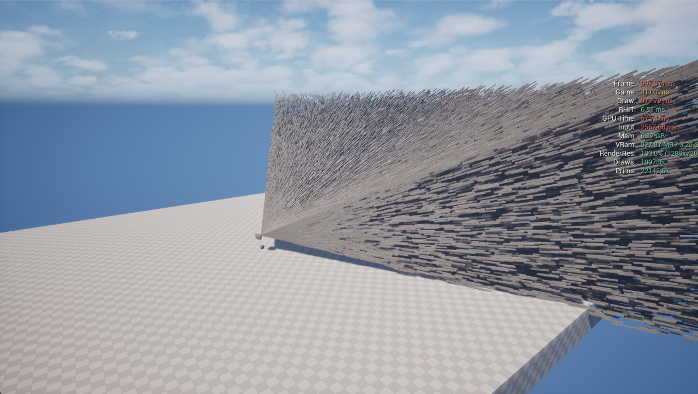
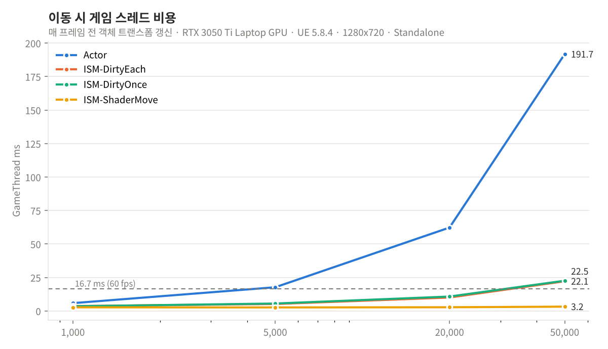
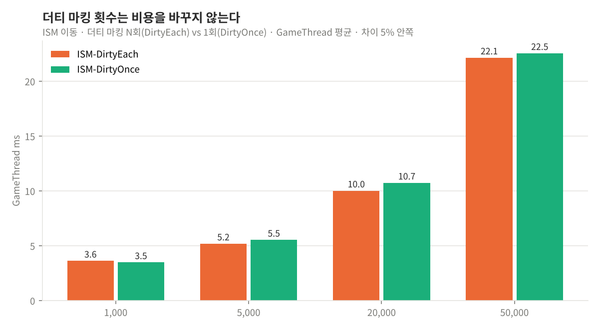
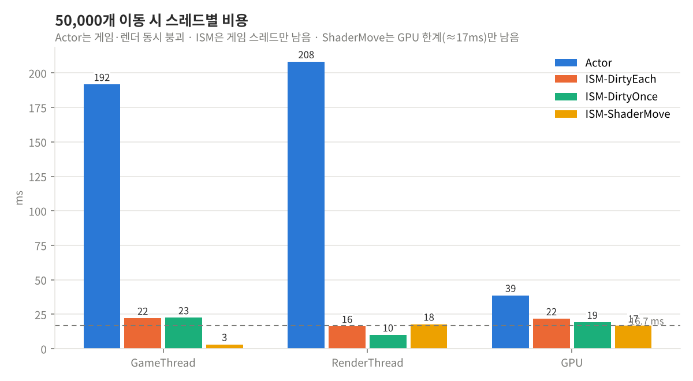
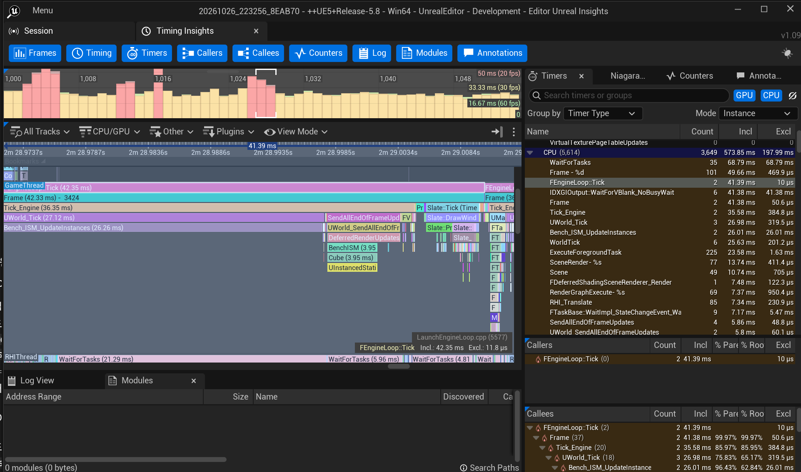
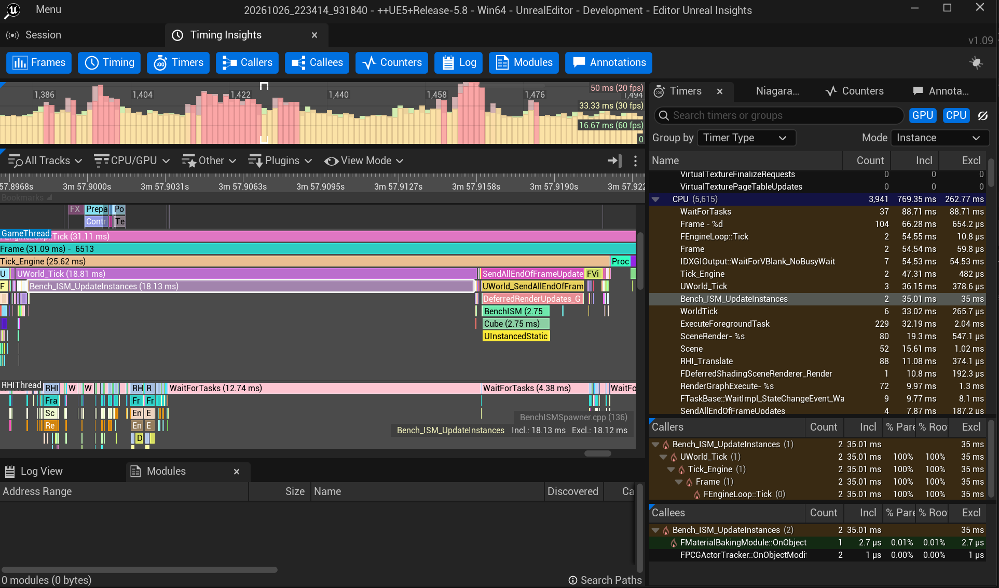

# InstanceBatch — ISM 갱신 비용은 어디서 나오는가

UE 5.8 대량 객체 렌더링 벤치마크. 실무에서 탄 궤적 수천 개를 액터로 그리다 8fps가 났고, ISM으로 바꾸고 호출을 정리해서 60fps로 올렸다. 그때 더티 플래그도 마지막에 한 번만 주도록 바꿨는데 그게 얼마나 효과였는지는 모른 채 넘어갔다. 그래서 개인 프로젝트에서 같은 구조를 만들어 방식·개수·이동을 하나씩 바꿔 가며 재봤다.

| 호출당 비용 | 60fps 한계 | 더티 플래그 횟수 | Actor → ISM → WPO (게임 스레드) |
|:---:|:---:|:---:|:---:|
| **0.39 μs** | **≈ 4만 개** | **차이 없음** (8회, 5% 안쪽) | **192 → 22 → 3 ms** |

기술: UE 5.8.4 · C++ · Unreal Insights · ISM / PerInstanceCustomData / WPO · `TRACE_CPUPROFILER_EVENT_SCOPE` · CVar 자동 sweep → CSV

- 기술 문서: [Docs/bench-design.md](Docs/bench-design.md) (설계 · 측정 환경 · 결과 · 원인 · 적용)
- 시연 영상: _(링크 추가 예정)_
- 원본 데이터: [Docs/bench_results.csv](Docs/bench_results.csv) · 그래프 재생성: `python Tools/plot_results.py`



## 결론 세 가지 (UE 5.8.4, Standalone, 5만 개 이동)

1. **더티 플래그는 몇 번을 해도 동일하다.** 5만 번과 1번을 비교해 보니 게임 스레드 비용이 같았다(더티 비교는 별도 8회 측정, 5% 안쪽). 엔진이 프레임 끝에 한 번 모아 처리한다. 이를 확인한 후 실무 소스를 다시 프로파일링하니, 비용은 더티가 아니라 한 프레임에 같은 인스턴스가 여러 번 갱신되던 호출 수였다.
2. **ISM 갱신 비용은 호출 수에 선형이다.** 호출당 약 0.39μs, 5만 개면 +19.5ms. 갱신만으로 60fps 예산을 다 쓰는 지점이 약 4만 개다.
3. **이동을 머티리얼로 넘기면 CPU 갱신 호출이 없어진다.** 5만 개에서 게임 스레드가 빈 씬 대비 +0.6ms(별도 측정한 20만 개에서도 게임 스레드 전체 5~7ms). 대신 CPU가 위치를 모른다.






비교 지표는 게임 스레드다. 렌더 스레드 값은 GPU 완료 대기를 포함해 프레임 시간과 함께 움직여 방식 비교에 쓰지 않았다. 위 표는 2회 평균이고, 더티 비교는 추가로 Standalone 5회·PIE 3회를 반복했다([기술 문서 5절](Docs/bench-design.md)). 표의 DirtyEach/DirtyOnce 렌더·GPU 차이는 그 5회 중 1회차에서만 나타났고 나머지는 같았다(편차). 렌더·GPU 분석은 이번 범위 밖이다.

## 실험

같은 씬(고정 카메라, 같은 배치, 같은 움직임)에서 방식만 바꿔 가며 쟀다. 변수는 방식 × 객체 수(1천/5천/2만/5만) × 정지·이동.

| 방식 | 구조 | 매 프레임 CPU가 하는 일 |
|---|---|---|
| Actor | Actor 1개 + StaticMeshComponent 1개 × N | 각 액터 Tick에서 `SetActorLocation` |
| ISM-DirtyEach | ISM 컴포넌트 1개 | `UpdateInstanceTransform(i, T, true, bMarkDirty=true)` × N |
| ISM-DirtyOnce | 위와 동일 | 같은 호출, 더티 플래그는 마지막 인스턴스에만 true |
| ISM-ShaderMove | 위와 동일 | 없음. 방향·위상을 PerInstanceCustomData에 1회 기록, 이동은 머티리얼 WPO |

측정값은 `stat unit`과 같은 소스(`GGameThreadTime` / `GRenderThreadTime` / `GRHIThreadTime` / `RHIGetGPUFrameCycles`). 워밍업 60프레임을 버리고 60프레임 평균. Lumen GI·반사, VSM, 레이트레이싱, 거리장을 꺼서 렌더 기능 비용이 객체 처리 비용을 가리지 않게 했다.

## 원인 — Insights

두 녹화의 게임 스레드 타임라인은 구조가 같다. `Bench_ISM_UpdateInstances` 루프 1개와 프레임 끝 `SendAllEndOfFrameUpdates → DeferredRenderUpdates → BenchISM` 1개. 더티 마킹은 플래그만 세우고, 실제 처리는 호출이 5만 번이든 1번이든 프레임 끝에 한 번이다. 증거 수준을 나누면: 측정(8회 모두 루프 시간 동일) → Insights(처리 블록이 하나) → 엔진 헤더(그렇게 적혀 있음).

| DirtyEach (코드상 더티 5만 회) | DirtyOnce (코드상 더티 1회) |
|---|---|
|  |  |

엔진 쪽 근거(`ISMInstanceDataManager.cpp`): `TransformChanged`는 인스턴스 비트 하나를 세우고, `MarkComponentRenderInstancesDirty`는 `bComponentMarkedDirty` 플래그로 막혀 플러시당 1회만 컴포넌트를 더티로 만든다. `FlushChanges`가 프레임 끝에 바뀐 인스턴스만 모아 태스크로 넘긴다. 5.4와 5.8 헤더가 같다.

## 그래서 어떻게 쓰나

| 상황 | 선택 | 이유 |
|---|---|---|
| 개별 판정이 필요 없는 대량 이동 (탄막 연출, 풀, 파편, 배경 군중) | ISM + 셰이더 이동 | 인스턴스별 CPU 갱신 없음. 단 충돌·피격 불가, 바운드 고정 |
| 개별 판정이 필요한 대량 이동 (피격되는 탄환, RTS 유닛) | ISM + CPU 갱신 | 호출당 ≈0.4μs 선형. 프레임당 호출 수를 줄이는 데 집중 |
| 소수의 복잡한 객체 | Actor | 수천 개부터 게임·렌더 스레드가 함께 무너짐 |

대량 객체가 느려지면 stat unit의 게임 스레드부터 보고 프레임당 갱신 호출 수를 센다. 코드 리뷰에서는 갱신 함수를 호출하는 곳이 몇 군데인지, 틱인지 이벤트인지 센다. 더티 플래그 횟수는 보지 않는다.

## 사용법

```
lab.Mode 0|1|2|3      # Actor / ISM-DirtyEach / ISM-DirtyOnce / ISM-ShaderMove
lab.Count 50000
lab.Moving 1
lab.Record 1          # 워밍업 후 60프레임 평균 → Saved/Bench/bench_results.csv
lab.Sweep 1           # 모든 조합 자동 측정 (lab.Sweep.Modes, lab.Sweep.Counts)
```

Standalone(`-game`)에서 `r.SetRes 1280x720w` 후 측정. 첫 sweep은 워밍업으로 버린다.

```
Plugins/BatchBench/Source/Bench/
├── Public/IBatchSpawner.h        # Spawn / SetMoving / Clear / TickSpawner
├── Public/BenchLayout.h          # 결정적 탄막 배치 (방향·반경·속도)
├── Private/BenchSubsystem.cpp    # CVar → 스포너 생성, sweep, 카메라
├── Private/BenchRecorder.cpp     # stat unit 소스 → CSV
└── Private/Spawners/             # Actor / ISM (DirtyEach·DirtyOnce·ShaderMove)
```

## 한계

- 엔진 기능을 쓰는 쪽의 분석이다. 엔진 소스 수정이나 커스텀 렌더 경로는 없다.
- 노트북 GPU(RTX 3050 Ti) 한 대 기준. 절대값은 환경마다 다르고, 다른 환경에 옮겨 쓸 수 있는 건 경향(선형 증가, 더티 횟수 무관, 셰이더 이동 시 CPU 갱신 없음)이다.
- 실무는 5.4, 벤치는 5.8. 헤더 구조는 같으나 구현 차이까지 확인하지는 못했다.

제작: 코드 생성에 Claude Code를 활용했다. 실험 설계, 측정 조건, Insights 해석, 결론은 직접 했다.
